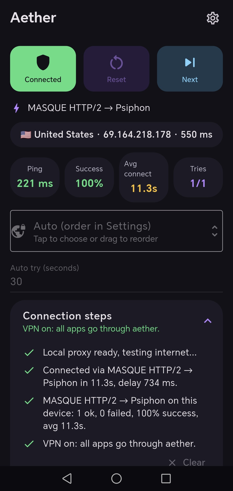

## 🖼️ Application Preview

<table>
  <tr>
    <th width="33%">Desktop - Main</th>
    <th width="33%">Desktop - Settings</th>
    <th width="33%">Android</th>
  </tr>
  <tr>
    <td align="center">
      
    </td>
    <td align="center">
      
    </td>
    <td align="center">
      
    </td>
  </tr>
</table>

## Release process

Before releasing, add a `## X.Y.Z` section with short, user-facing changes in Persian to `flutter/assets/release_notes.txt`. Both apps bundle these notes and show them on the first launch after upgrading.

All releases must be created with `./release.sh X.Y.Z`. On Windows, run `release.bat X.Y.Z`, which delegates to the same script. Do not publish releases manually; the script is responsible for tests, Windows and Android builds, reports, version commits, tags, pushes, and GitHub release assets.

## Credits

- **[g62862560-ctrl](https://github.com/g62862560-ctrl)**
- **[CluvexStudio/Aether](https://github.com/CluvexStudio/Aether)**
- **[heiher/hev-socks5-tunnel](https://github.com/heiher/hev-socks5-tunnel)**
