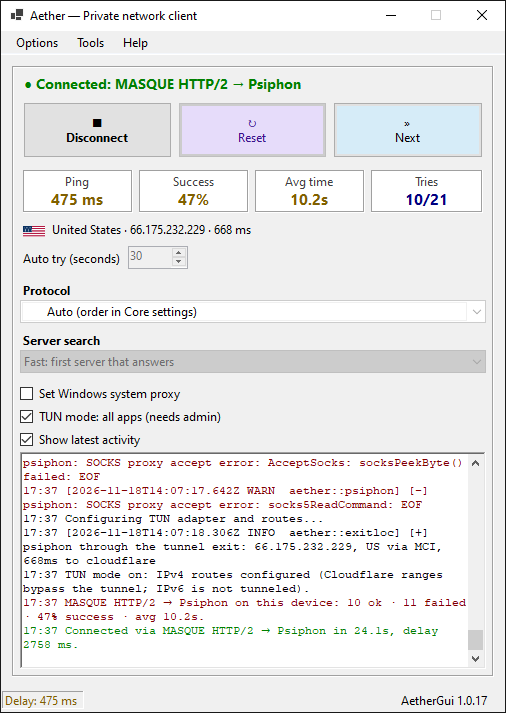
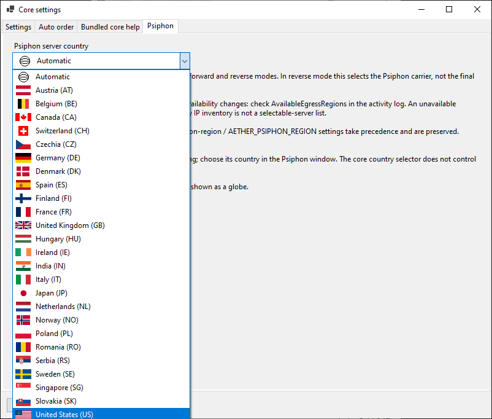

## 🖼️ Application Preview

<table>
  <tr>
    <th width="30%">Desktop - Main</th>
    <th width="30%">Desktop - Settings</th>
    <th width="40%">Android</th>
  </tr>
  <tr>
    <td align="center">
      
    </td>
    <td align="center">
      
    </td>
    <td align="center">
      
    </td>
  </tr>
</table>

## Credits

- **[g62862560-ctrl](https://github.com/g62862560-ctrl)** — AetherGui development, implementation, and customization.
- **[CluvexStudio/Aether](https://github.com/CluvexStudio/Aether)** — Original Aether project, design, and inspiration.

Special thanks to CluvexStudio for their original work.

AetherGui builds upon the ideas and foundation of Aether, with additional development and improvements.
